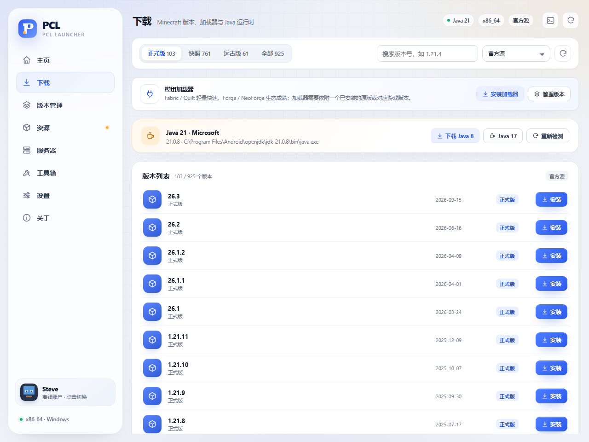
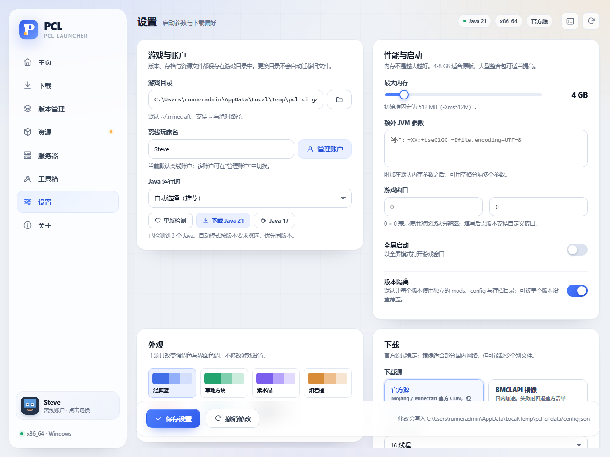
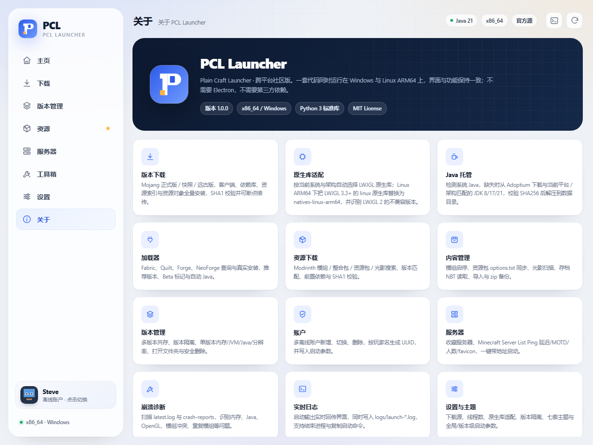
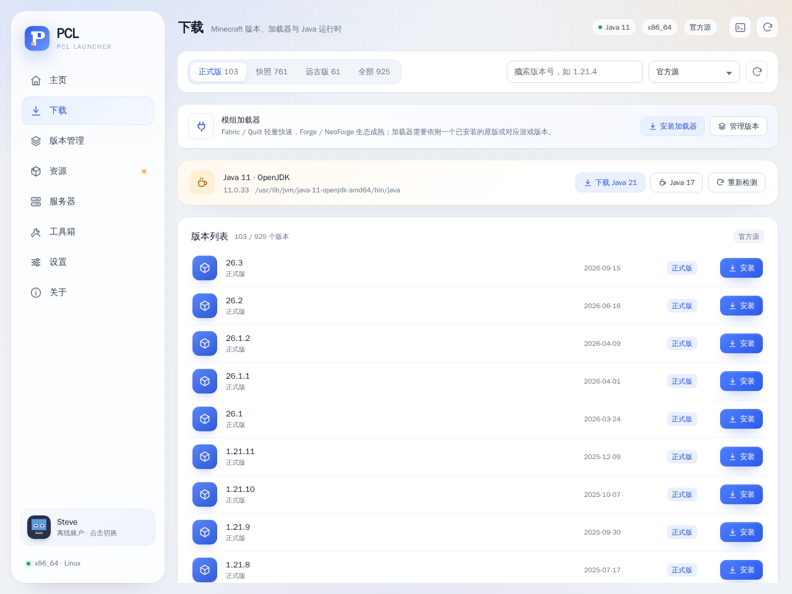
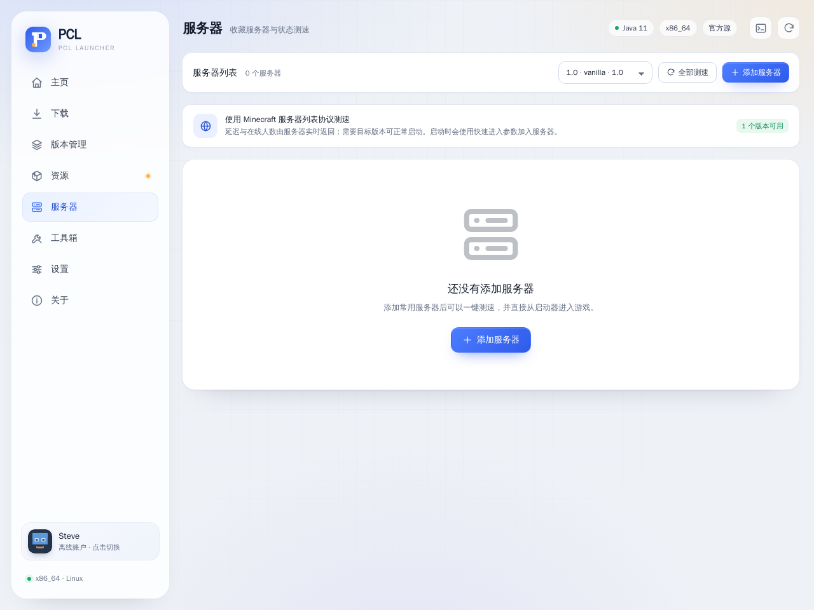

# PCL Launcher · Windows / Linux ARM64

**Plain Craft Launcher 风格的跨平台 Minecraft 启动器。**

同一套后端与同一套 Web 界面，同时交付：

- **Windows 10/11 x64**：单文件 `PCL-Launcher.exe`，双击即用，不需要 Python。
- **Linux ARM64**：`.deb` 安装包 + 通用 `tar.gz` 安装包，安装后命令为 `pcl-launcher`。

不需要 Electron。窗口壳使用 pywebview：Windows 使用系统 WebView2，Linux 使用系统 GTK3 + WebKit2GTK。版本下载、加载器安装、Modrinth 资源、账户、服务器测速、启动与崩溃诊断全部内置。设置页可以直接选择游戏/启动目录。

> 本项目是非官方社区实现，与 Mojang Studios、Microsoft、Plain Craft Launcher 官方没有隶属关系。请购买正版 Minecraft。

---

## 下载

| 平台 | 文件 | 说明 |
| --- | --- | --- |
| Windows x64 | [`dist/PCL-Launcher.exe`](https://raw.githubusercontent.com/thy2014/PCL-Linux-ARM64/main/dist/PCL-Launcher.exe) | 单文件桌面窗口，双击运行，不需要 Python |
| Linux ARM64 · Debian/Ubuntu | [`dist/PCL-Launcher_1.0.0_arm64.deb`](https://raw.githubusercontent.com/thy2014/PCL-Linux-ARM64/main/dist/PCL-Launcher_1.0.0_arm64.deb) | 系统安装包，创建窗口应用、命令与桌面入口 |
| Linux ARM64 · 通用 | [`dist/PCL-Launcher_1.0.0_linux_arm64.tar.gz`](https://raw.githubusercontent.com/thy2014/PCL-Linux-ARM64/main/dist/PCL-Launcher_1.0.0_linux_arm64.tar.gz) | 不依赖 dpkg 的发行版 |
| Linux ARM64 · 单 Python 文件 | [`pcl-single.py`](https://raw.githubusercontent.com/thy2014/PCL-Linux-ARM64/main/pcl-single.py) | 只需要 Python 3.10+，适合调试 |

### Windows 单文件窗口 exe

1. 下载 `PCL-Launcher.exe`。
2. 双击运行，会打开一个独立的桌面窗口，不再依赖浏览器标签页。
3. 如果 SmartScreen 提示“未知发布者”，选择“更多信息 → 仍要运行”。这是未签名程序的正常提示。

不需要安装 Python。应用数据默认在：

```text
%APPDATA%\PCL
```

游戏目录默认在：

```text
%USERPROFILE%\.minecraft
```

在“设置 → 游戏与账户 → 游戏目录”右侧点“选择”，即可调用 Windows 原生文件夹选择框；选择后点“保存设置”生效。

### Linux ARM64 · Debian / Ubuntu

```bash
sudo apt install ./PCL-Launcher_1.0.0_arm64.deb
pcl-launcher
```

也可以：

```bash
sudo dpkg -i PCL-Launcher_1.0.0_arm64.deb
```

安装后会创建：

- `/usr/bin/pcl-launcher`
- `/usr/share/pcl-launcher/pcl-single.py`
- `/usr/share/applications/pcl-launcher.desktop`
- `/usr/share/icons/hicolor/256x256/apps/pcl-launcher.png`

从应用菜单搜索“PCL Launcher”即可打开桌面窗口。`.deb` 会自动安装 `python3-gi`、`python3-gi-cairo`、GTK3 与 WebKit2GTK 依赖。

### Linux ARM64 · 通用 tar.gz

```bash
tar -xzf PCL-Launcher_1.0.0_linux_arm64.tar.gz
cd PCL-Launcher_1.0.0_linux_arm64
./install.sh
```

默认安装到 `~/.local/share/pcl-launcher`，命令链接到 `~/.local/bin/pcl-launcher`。可选：

```bash
./install.sh --prefix=/opt/pcl --run
```

卸载：

```bash
./uninstall.sh            # 保留 ~/.pcl-arm64 数据
./uninstall.sh --purge    # 连同数据目录一起删除
```

要求 Python **3.10+**，以及系统的 GTK3 / WebKit2GTK：

```bash
# Debian / Ubuntu
sudo apt install python3 python3-gi python3-gi-cairo gir1.2-gtk-3.0 gir1.2-webkit2-4.0
```

窗口版不依赖 pip 安装的第三方库；`pcl-single.py` 已内嵌 pywebview 窗口壳。若系统缺少 GTK/WebKit，可用 `python3 pcl-single.py --browser` 回退到浏览器模式，但原生目录选择器不可用。

### Linux ARM64 · 只运行单文件

```bash
curl -fsSL https://raw.githubusercontent.com/thy2014/PCL-Linux-ARM64/main/pcl-single.py -o pcl-single.py
python3 pcl-single.py
```

首次运行会把内置运行时释放到 `~/.cache/pcl-launcher/single/<内容哈希>/`，之后复用。单文件版与安装包内的代码完全一致，只是少一个系统命令入口。

---

## 桌面窗口与启动目录

- 默认启动的是独立桌面窗口，不是浏览器标签页；Windows 使用 WebView2，Linux 使用 GTK3 + WebKit2GTK。
- “设置 → 游戏与账户 → 游戏目录”右侧的“选择”按钮会调用系统原生文件夹选择框。
- 选中的目录会在点击“保存设置”后写入 `config.json`，之后下载版本、安装加载器、扫描存档和启动游戏都以该目录为根目录。
- 应用数据目录与游戏目录分离：数据目录放配置、日志、Java 运行时；游戏目录放 `versions / libraries / assets / saves / mods`。
- 需要浏览器调试或系统缺少 WebKit 时，使用 `--browser`；完全无界面时使用 `--no-window --no-browser`。

---

## 两个版本完全一样

Windows exe 和 Linux ARM64 安装包共用同一份 `pcl_core/` 与 `web/`：

| 项目 | Windows exe | Linux ARM64 安装包 |
| --- | --- | --- |
| 后端 | 同一份 `pcl_core/` | 同一份 `pcl_core/` |
| 界面 | 同一份 `web/` 中的 HTML/CSS/JS | 同一份 `web/` |
| 窗口壳 | 同一套 pywebview，使用系统 WebView2 | 同一套 pywebview，使用系统 GTK3 + WebKit2GTK |
| API | 同一套 JSON API 与 CSRF token | 同一套 JSON API 与 CSRF token |
| 目录选择 | Windows 原生文件夹选择框 | GTK 原生文件夹选择框 |
| 功能 | 版本、加载器、Modrinth、账户、服务器、诊断 | 相同 |
| 平台差异 | Java 路径、`%APPDATA%` 数据目录、Windows 原生库 | Java 路径、`~/.pcl-arm64` 数据目录、ARM64 原生库替换 |

启动器只做平台适配，不维护两套前端，也不维护两套窗口 UI。Windows 端当前实测：

- exe 启动后打开独立桌面窗口，`/api/bootstrap` 返回 `PCL Launcher 1.0.0`。
- 首页、下载、设置、关于页正常渲染，窗口内没有浏览器地址栏。
- 设置页“选择”按钮可以拉起 Windows 原生文件夹选择框，选择路径并保存。
- `/`、`/css/app.css`、`/js/app.js`、`/assets/logo.svg` 全部 HTTP 200。
- 自动检测到系统 Java 21（Microsoft / Zulu）。

Linux ARM64 端当前实测：

- `.deb` 的 `Architecture: arm64`、`Depends: python3 (>= 3.10), python3-gi, ... WebKit2GTK` 正确。
- 解包后 `PCL Launcher 1.0.0` 可运行；窗口在 GTK 桌面下打开。
- 设置页“选择”按钮可以拉起 GTK 原生目录选择框，选择路径并保存。
- 通用 tar 安装脚本可创建 `pcl-launcher` 命令和桌面入口。
- 启动服务后首页与 API 正常返回。

由于当前构建机是 Linux `x86_64`，真正 ARM64 桌面上的游戏进程启动仍需在目标设备上验收；安装、文件下载、启动命令构建和界面已经验证。Windows 端已验证界面与 API，真实进入 Minecraft 主菜单同样建议在目标机点一次“启动”。

---

## 界面预览

Windows exe：

| 主页 | 下载 |
| --- | --- |
|  |  |

| 设置 | 关于 |
| --- | --- |
|  |  |

Linux 安装包（同一套界面，仅系统标签不同）：

| 主页 | 下载 |
| --- | --- |
|  |  |

| 资源（Modrinth） | 服务器 |
| --- | --- |
|  |  |

| 设置 | 工具箱 |
| --- | --- |
|  |  |

---

## 功能

### 版本与启动

- Mojang 官方版本清单：正式版、快照、远古版本，支持搜索与筛选。
- 原版完整安装：客户端 jar、依赖库、资源索引、全部资源对象、natives。
- 文件 SHA1 校验、断点下载、并发下载、安装任务取消与实时进度。
- 安装进度展示下载速度、文件计数、字节计数、当前文件、日志。
- 多版本共存、版本大小统计、最近启动时间、删除版本。
- 版本隔离：每个版本独立的 `mods / config / saves / options.txt`。
- 全局与单版本设置：内存、JVM 参数、Java 路径、窗口尺寸、全屏。
- 启动命令构建：规则解析、参数模板替换、classpath、natives、资源目录、账户 UUID/token。
- 游戏进程实时日志、退出码、PID、日志落盘、复制启动命令、结束进程。
- 快速进入服务器：为支持 Quick Play 的版本附加 `--quickPlayMultiplayer`。

### 模组加载器

- **Fabric**：官方 meta profile 合并安装。
- **Quilt**：官方 meta profile 合并安装。
- **Forge**：下载官方 installer，执行 `--installClient`，合并生成版本。
- **NeoForge**：下载官方 installer，执行 `--installClient`。
- 加载器版本列表、推荐版本、Beta 标记。
- 加载器安装复用原版安装器，自动准备 Java、资源与依赖。
- 安装原版时可在同一个弹窗、同一个任务里顺带选择 Fabric / Forge / NeoForge / Quilt，避免装完原版再单独装加载器。
- 安装完成后自动识别 `loader` / `game_version`，在版本卡片显示。

### 资源下载（Modrinth）

- 模组、整合包、资源包、光影四类搜索。
- 按已安装版本的游戏版本与加载器过滤。
- 项目版本选择、SHA1 校验、必需前置模组递归安装。
- `.mrpack` 整合包安装：基于所选版本创建独立实例，复制基础客户端与依赖。
- 资源安装任务与进度、失败原因提示。

### 内容管理

- 模组：扫描 `.jar` / `.jar.disabled`，读取 `fabric.mod.json`、`quilt.mod.json`、`mods.toml`、`mcmod.info`，启停与删除。
- 资源包：扫描 zip/目录，读取 `pack.mcmeta`，启停同步写入 `options.txt`。
- 光影：扫描 `shaderpacks`，显示文件大小与修改时间。
- 存档：扫描 `saves`，读取 `level.dat` 的 NBT。
- 导入：从本机路径复制模组/资源包到版本目录。
- 存档备份：zip 打包到 `backups/`。

### 账户、服务器与诊断

- 多离线账户：新增、切换、删除，按玩家名生成离线 UUID。
- 服务器列表：新增、编辑、删除、持久化。
- Minecraft Server List Ping：延迟、MOTD、在线/最大玩家、版本、favicon。
- 一键测速全部服务器；从服务器页直接带地址启动。
- 崩溃诊断：扫描 `latest.log`、`crash-reports`、模组数量和常见错误特征。
- 打开游戏目录、版本目录、日志目录、崩溃报告目录、Java 目录、数据目录。
- 主题：经典蓝、草地方块、紫水晶、熔岩橙、红石、海洋青、夜间。

### 平台适配

- Windows：官方 LWJGL Windows 原生库；`%APPDATA%\PCL` 数据目录；`java.exe / javaw.exe` 启动。
- Linux ARM64：LWJGL 3.3+ 的 `natives-linux` 自动替换为 `natives-linux-arm64`。
- Linux ARM64：识别 LWJGL 2 / 旧版 LWJGL 3，并在界面提示无法运行。
- Adoptium JDK：按当前平台与架构下载 JDK 8 / 17 / 21，SHA256 校验、解压。
- 系统 Java 自动发现，按版本要求挑选 Java 大版本。

详见 [docs/ARM64.md](docs/ARM64.md)。

---

## 实测记录（2026-11-24）

测试宿主：Linux `x86_64` + Windows `x64`。ARM64 部分通过 `PCL_ARCH=arm64` 模拟目标架构；ARM64 JDK 是真实下载并校验的 Adoptium 构建，但 x86 宿主不能执行 ARM64 ELF。以下项目均已跑通到安装/命令构建层面：

| 项目 | 结果 |
| --- | --- |
| Windows 单文件 exe | 10.3 MB，启动成功，首页/下载/设置/关于均正常，静态资源 200 |
| Windows Java 检测 | 自动识别 Microsoft Java 21、Zulu Java 21 |
| Linux ARM64 `.deb` | arm64 / Python 3.10+ 元数据正确，解包运行 `--version` 成功 |
| Linux ARM64 tar 安装 | `install.sh` 创建命令与桌面入口，`pcl-launcher` 可启动 |
| Minecraft 1.0 原版 | 480 文件、约 50.8 MB，客户端 SHA1 校验通过 |
| Minecraft 1.21.4 原版 | 4114 文件、约 694 MB，含 assets / libraries / natives |
| Adoptium Java 21 ARM64 | 206,031,041 B，SHA256 校验通过，解压可用 |
| Fabric 0.20.1 + 1.21.4 | 4120 文件安装完成，ARM64 原生库替换 8 个 |
| Quilt 0.20.0-beta.9 + 1.21.4 | 4126 文件安装完成 |
| Forge 47.4.28 + 1.20.1 | 官方 installer 执行成功，生成 `1.20.1-forge-47.4.28`；3661/3661 文件补齐，启动命令含 60 个参数 |
| NeoForge | 代码与 installer 流程已接入；测试网络访问 `maven.neoforged.net` 返回 502，未能实测 |
| Modrinth 模组 | Sodium 0.6.13、Iris 1.8.8 安装成功，Iris 的必需前置 Sodium 正确复用 |
| Modrinth 资源包 | Simple Wool v1.4 安装并写入实例 |
| Modrinth 整合包 | Simply Optimized & Up to Date 安装成功，写入 22 个覆盖文件 |
| 服务器状态 | Hypixel 真实 ping：679 ms、12934 / 200000 人 |
| 启动命令 | 1.0、1.21.4、Fabric、Quilt、整合包实例均可构建完整命令 |

> Forge 安装器需要在目标机上执行 Java。本项目把安装器工作目录设为游戏目录，并在安装完成后清理安装器临时生成的原版版本目录，避免“版本管理”里出现未完整安装的假版本。

---

## 从源码运行

### 环境要求

- Windows 10/11 x64，或 Linux ARM64（aarch64）。
- Python **3.10+**。
- pywebview 窗口壳：Windows 使用系统 WebView2；Linux 使用系统 GTK3 + WebKit2GTK（`python3-gi`）。
- 启动游戏需要桌面环境、可用的 OpenGL 驱动与音频设备；纯 SSH 无显示环境会回退到浏览器模式。

### 运行

```bash
git clone https://github.com/thy2014/PCL-Linux-ARM64.git
cd PCL-Linux-ARM64
python3 -m pip install -r requirements.txt
python3 pcl.py
```

Windows：

```powershell
py -m pip install -r requirements.txt
py pcl.py
```

默认打开一个独立的 `PCL Launcher` 桌面窗口，窗口内没有浏览器地址栏。端口被占用会自动顺延，终端会打印实际地址。需要浏览器调试时：

```bash
python3 pcl.py --browser
```

### 构建

```bash
# 单文件 Python（Linux ARM64 安装包内部使用；需要 pywebview）
python3 -m pip install pywebview
python3 tools/build_single.py

# Linux ARM64 .deb + tar.gz
bash packaging/linux/build_deb.sh

# Windows 单文件窗口 exe（在 Windows 上执行）
powershell -File packaging/windows/build.ps1
```

Windows 构建脚本会自动安装 PyInstaller 与 pywebview：

输出：

```text
dist/PCL-Launcher.exe
dist/PCL-Launcher_1.0.0_arm64.deb
dist/PCL-Launcher_1.0.0_linux_arm64.tar.gz
```

### 命令行参数

```text
--host        监听地址，默认 127.0.0.1
--port        监听端口，默认 3919
--data-dir    应用数据目录；Windows 默认 %APPDATA%\PCL，Linux 默认 ~/.pcl-arm64
--game-dir    游戏目录，默认 ~/.minecraft
--arch        arm64 / x86_64 / arm32（调试用）
--no-window   不打开桌面窗口（服务端模式）
--browser     强制使用浏览器打开（调试用）
--no-browser  回退浏览器时也不自动打开
--version     显示版本
```

示例：

```bash
python3 pcl.py --game-dir ~/Games/Minecraft --port 4000
python3 pcl.py --no-window --no-browser --port 4000
```

---

## 数据目录

Windows：

```text
%APPDATA%\PCL\
├── config.json
├── accounts.json
├── servers.json
├── java\
├── logs\
└── cache\
```

Linux ARM64：

```text
~/.pcl-arm64/
├── config.json
├── accounts.json
├── servers.json
├── java/
├── logs/
└── cache/
```

游戏目录（两个平台一致）：

```text
~/.minecraft/
├── assets/
├── libraries/
├── versions/
│   └── <version>/
│       ├── mods/
│       ├── resourcepacks/
│       ├── shaderpacks/
│       ├── saves/
│       └── logs/
```

版本隔离开启时，`mods / config / saves / options.txt` 位于 `versions/<version>/`；关闭时与全局游戏目录共用。

---

## 项目结构

```text
pcl.py                     # 多文件版入口、CLI、本地 HTTP 服务启动
pcl-single.py              # 单文件版（内置 pcl_core 与 web/）
tools/
└── build_single.py        # 重新生成 pcl-single.py
pcl_core/
├── config.py              # 配置、目录、架构检测、版本隔离
├── util.py                # 哈希、解压、UUID、原子写入、路径安全
├── http_client.py         # JSON / 断点下载 / SHA 校验
├── tasks.py               # 后台任务、进度、日志、取消
├── minecraft.py           # 版本清单、规则、库解析、平台原生库、版本 JSON 合并
├── installer.py           # 原版/加载器共用安装流水线
├── java_runtime.py        # Java 发现、Adoptium 下载（Windows / Linux）
├── launcher.py            # 启动参数构建与进程管理
├── loaders.py             # Fabric / Quilt / Forge / NeoForge
├── modrinth.py            # 搜索、版本、依赖、.mrpack
├── content.py             # 模组/资源包/光影/存档/NBT/备份
├── accounts.py            # 离线账户
├── servers.py             # 服务器列表与 Server List Ping
├── diagnostics.py         # 崩溃/日志启发式诊断
└── server.py              # HTTP API、静态文件、CSRF token
web/
├── index.html
├── css/app.css
└── js/
    ├── api.js
    ├── ui.js
    ├── app.js
    └── pages/
packaging/
├── windows/
│   ├── build.ps1
│   ├── version_info.txt
│   └── icon.ico
└── linux/
    ├── build_deb.sh
    ├── install.sh
    ├── uninstall.sh
    ├── pcl-launcher
    ├── pcl-launcher.desktop
    └── pcl-launcher.png
docs/
├── ARM64.md
└── screenshots/
tests/
└── test_core.py
```

---

## API 摘要

所有接口返回 JSON。写操作需要 `X-PCL-Token` 请求头。

| 方法 | 路径 | 说明 |
| --- | --- | --- |
| GET | `/api/bootstrap` | 启动数据、设置、Java、版本、账户、服务器、任务、token |
| GET | `/api/versions` | Mojang 版本清单 |
| GET | `/api/installed` | 已安装版本 |
| POST | `/api/install` | 开始原版安装任务；可选 `loader_type` + `loader_version` 在同一任务中原版后继续装加载器 |
| GET | `/api/java` | Java 列表 |
| POST | `/api/java/download` | 下载 Adoptium JDK |
| POST | `/api/launch` | 构建启动命令并启动 |
| GET/POST | `/api/launch` | 查询/停止进程 |
| GET | `/api/loaders` | 支持的加载器 |
| GET | `/api/loader/versions` | 加载器版本列表 |
| POST | `/api/loader/install` | 安装加载器 |
| GET | `/api/modrinth/search` | Modrinth 搜索 |
| GET | `/api/modrinth/versions` | 项目版本 |
| POST | `/api/modrinth/install` | 安装模组/资源包/光影 |
| POST | `/api/modrinth/install_modpack` | 安装 `.mrpack` |
| GET | `/api/content` | 扫描版本内容 |
| POST | `/api/content/toggle` | 启停模组/资源包 |
| POST | `/api/content/delete` | 删除内容 |
| POST | `/api/content/import` | 从本机路径导入 |
| POST | `/api/content/backup` | 备份存档 |
| GET/POST | `/api/version/settings` | 版本隔离与单版本设置 |
| GET | `/api/accounts` | 账户列表 |
| POST | `/api/accounts/add` | 新增离线账户 |
| POST | `/api/accounts/select` | 切换账户 |
| POST | `/api/accounts/remove` | 删除账户 |
| GET | `/api/servers` | 服务器列表 |
| POST | `/api/servers/add` | 新增服务器 |
| POST | `/api/servers/update` | 编辑服务器 |
| POST | `/api/servers/delete` | 删除服务器 |
| GET | `/api/servers/ping` | Server List Ping |
| GET | `/api/diagnose` | 崩溃诊断 |
| GET | `/api/task/<id>` | 任务状态 |
| POST | `/api/task/<id>/cancel` | 取消任务 |

完整参数见 `pcl_core/server.py`。

---

## 启动失败排查

| 现象 | 原因 / 处理 |
| --- | --- |
| Windows 双击后没有窗口 | 启动器是本地 Web 应用，不会弹出桌面窗口；默认在浏览器打开 `http://127.0.0.1:3919/`。若浏览器未打开，手动访问终端/日志里的地址 |
| Windows SmartScreen 拦截 | 未签名 exe 的正常提示；点“更多信息 → 仍要运行” |
| Linux `pcl-launcher: command not found` | `~/.local/bin` 不在 PATH；直接运行 `~/.local/bin/pcl-launcher`，或把该目录加入 `~/.profile` |
| Linux 提示没有 python3 | `sudo apt install python3`；要求 3.10+ |
| 只下载了脚本，报 `can't open file 'pcl.py'` | 使用单文件 `pcl-single.py`，或下载完整仓库；不要只拿旧的 `start.sh` |
| 终端没有弹出浏览器 | 看终端打印的“界面地址”，手动打开；服务默认只监听 `127.0.0.1` |
| 提示“当前不是 ARM64” | 当前 Linux 机器是 x86_64；界面与下载可用，但 ARM64 原生库补丁不会生效 |
| Windows 启动游戏闪退 | 检查 Java 版本是否匹配（1.17+ 需要 Java 17/21，1.16 及以下通常需要 Java 8）；在“设置 → Java”中指定 |

---

## 测试

```bash
python3 -m unittest discover -s tests -v
```

测试覆盖离线 UUID、版本 JSON 合并、Maven 路径、自定义 Maven 仓库回退、配置版本隔离、账户存储等纯本地逻辑，不访问网络。

---

## 与 PCL2 的差异

本项目目标是覆盖 PCL2 的主要日常功能，但不是 PCL2 源码移植。当前明确未内置的能力：

| 能力 | 状态 | 原因 |
| --- | --- | --- |
| 微软正版登录 | 未内置 | 需要 Azure 应用与 OAuth 回调；当前使用离线账户 |
| CurseForge 资源下载 | 未内置 | CurseForge API 需要 API Key，且条款限制第三方启动器 |
| OptiFine / LiteLoader 自动安装 | 未内置 | OptiFine 下载受官网验证限制；LiteLoader 已停止维护 |
| 旧版（≤1.12）在 Linux ARM64 启动 | 不支持 | 使用 LWJGL 2，官方无 ARM64 原生库 |
| 旧版（≤1.12）在 Windows 启动 | 支持 | Windows 官方提供 LWJGL 2 原生库 |
| 启动器自动更新 | 未内置 | 需先设计签名与更新通道 |
| 皮肤 / 披风上传 | 未内置 | 依赖 Mojang 正版账户体系 |
| 整合包导出 / 分享码 | 未内置 | 当前只支持 `.mrpack` 导入 |
| macOS 打包 | 未提供 | 代码可运行，但本次只交付 Windows 与 Linux ARM64 |

如果某项能力对你必须，请在 Issues 中说明使用场景。

---

## License

[MIT](LICENSE)

## 致谢

- [Plain Craft Launcher 2](https://github.com/Hex-Dragon/PCL2) — 界面与功能设计灵感，本项目与官方无隶属关系。
- Mojang Studios / Microsoft — Minecraft 版本元数据与下载接口。
- FabricMC、QuiltMC、MinecraftForge、NeoForged — 加载器元数据与安装器。
- Modrinth — 资源搜索与下载 API。
- Adoptium — JDK 构建。
